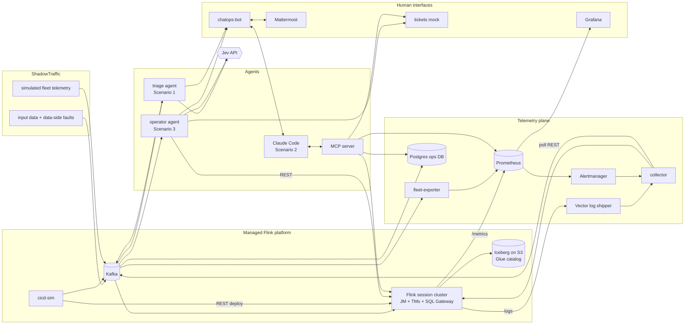

# Demo Design: From Alerts to Autonomy

Status: draft, 2026-10-20. Authors: Bobby Calderwood, Andrew Lee, with Claude Code.

This document describes the demos for the talk *From Alerts to Autonomy: Advancing the Maturity Curve with Agentic Managed Streaming Platforms*. The talk abstract is in [README.md](../README.md).

## 1. Goals

Three live demos, one for each stage of the agentic support maturity curve:

1. **Amplify signal, suppress noise.** A flood of fleet alerts becomes a small number of real, enriched signals.
2. **Human-initiated, agent-assisted diagnosis and remediation.** An engineer asks an agent about an incident in ChatOps. The agent correlates logs, metrics, deployment history and point-in-time state, finds the root cause and proposes a fix. The human approves it.
3. **Agent-initiated diagnosis and remediation.** An agent handles routine incidents end to end: it remediates, verifies the fix, keeps the ticket and the humans informed, and escalates only when necessary.

**Each scenario builds on the previous one.** The signals Scenario 1 produces are what Scenario 2's engineer investigates and what Scenario 3's agent acts on. The talk progresses along the maturity curve on one platform, rather than through three separate demos.

The audience is Current attendees who run, or will run, Flink for many user teams. The demos must:

- **Be believable.** Use real Flink, real Kafka, real Iceberg on real S3, and real REST API calls for remediation.
- **Show scale.** The noise problem only appears with a large fleet, so the demo simulates one.
- **Be repeatable.** Timelines are scripted and seeded so the live run matches rehearsal.
- **Be legible.** The audience can see where the model makes a judgment and where code enforces policy.

The business logic of the Flink jobs doesn't matter. The talk is about operating many opaque, user-provided jobs.

### Non-goals

- Production-grade infrastructure, high availability or security hardening. The setup is a single instance used only for the demo.
- A general-purpose agent framework.
- Running OpenJev/SemIf locally. Hosted Jev is the default; see §6.

## 2. Decisions

| # | Decision | Rationale |
|---|---|---|
| D1 | **Real Flink in Docker Compose**, with a handful of real jobs | Real telemetry, and remediation that really changes things |
| D2 | **ShadowTraffic** for input data to the real jobs and for **simulated fleet telemetry** | Supplies the scale and noise Scenario 1 needs without running thousands of jobs |
| D3 | **One telemetry plane**: simulated telemetry uses the same schemas and metric names as real telemetry | Agents treat real and simulated jobs the same way |
| D4 | **Scripted, seeded timelines** run by a director CLI | Fewer surprises during the live demo |
| D5 | **Jev for Scenarios 1 and 3**: typed `choice` / `noul` / `score` judgments over a finite set of outcomes | Deterministic, auditable, and every outcome maps to an action |
| D6 | **Claude Code for Scenario 2**, over an MCP server we build, bridged into Mattermost | Conversational investigation that stays in the ChatOps UI |
| D7 | **Rust, no agent harness**: explicit state machines, the `typesafe-ai` crate for Jev, `reqwest` for tools, `rmcp` for MCP | Jev isn't a tool-calling chat model, and code owns the workflow |
| D8 | **Swappable Jev endpoint** (Jev or OpenJev/SemIf via `base_url`) | Not tied to one provider. Both share the `/v1/systemone` API |
| D9 | **Mattermost in Compose** for ChatOps; **ServiceNow-shaped mock** for ticketing | Good visuals with nothing to procure; tickets appear as rich cards in chat |
| D10 | **Demo runs on one EC2 instance** (Graviton) using the same Compose stack. The laptop is for development and is the fallback | Relieves the 18 GB laptop limit, and the arm64 images are shared with the M3 |
| D11 | **Real S3 + AWS Glue Data Catalog** for Iceberg, checkpoints and savepoints on AWS. RustFS (S3-compatible) + Iceberg REST catalog locally, with the catalog's tables in Postgres | Believability; Glue is the simplest catalog. MinIO no longer publishes container images, so the local store is RustFS. The REST fixture's default SQLite backend failed concurrent commits with `SQLITE_BUSY` |
| D12 | **SSM Session Manager port forwarding** for access | No inbound ports, and only the AWS CLI is needed |
| D13 | **CloudFormation (plain YAML)** for infrastructure | See §10.1 |
| D15 | **Anthropic API** for Claude Code and **hosted Jev API**, with keys in SSM Parameter Store | Both keys are already available |
| D16 | **Each scenario builds on the last**: Scenario 1 signals start Scenarios 2 and 3 | One continuous story along the maturity curve |
| D14 | **Hedges come last**: a recorded replay fallback and similar safety nets are built only after the real thing works | Get the real thing running first |

## 3. System overview



Kafka is the event bus for all telemetry. The Postgres ops DB is the queryable history: point-in-time state, deployments, alerts, signals and actions. Prometheus holds all metrics, real and simulated.

## 4. Platform

### 4.1 Flink

- A **session cluster**: one JobManager, one or two TaskManagers, and the SQL Gateway. Flink 2.1.2: the newest release that both the Kafka connector (`5.0.0-2.1`) and the Iceberg Flink runtime (`iceberg-flink-runtime-2.1:1.11.0`) support.
- **Adaptive scheduler** enabled, so a rescale is a `PUT /jobs/:jobid/resource-requirements` call. TaskManagers keep spare slots so a rescale has room.
- **Short checkpoint interval (about 10 s)** and short timeouts, so failures show up within seconds, not minutes.
- **Retained checkpoints**, so a rollback can restore the previous version from the last good checkpoint.
- **Prometheus reporter** on the JobManager and TaskManagers.
- **Structured JSON logs** via the log4j2 `JsonTemplateLayout`, collected by Vector from container stdout.
- **State and checkpoints** go to `s3://…/checkpoints` and `s3://…/savepoints` on AWS, and to RustFS locally, through the Flink S3 filesystem plugin.

### 4.2 Jobs

A small set of jobs. Each one owns at most one starring failure mode (§7). Names and tenants are fictional.

| Job | Kind | Tenant (owner team) | Role in demo |
|---|---|---|---|
| `payments-enrichment` | Java DataStream | payments-eng | F1 bad deploy → Scenario 3 auto-rollback |
| `trade-events-ingest` | Java DataStream | trading-data | F2 poison records, with a recent benign deploy as a red herring → Scenario 2 |
| `positions-aggregator` | Java DataStream (keyed state) | risk-platform | F4 state growth → Scenario 3 escalation |
| `market-data-to-iceberg` | Flink SQL | market-data | F3 traffic spike / backpressure → Scenario 3 auto-rescale |
| `customer-events-to-iceberg` | Flink SQL | customer-360 | F5 schema drift (stretch goal) |
| `audit-log-archiver` | Flink SQL | compliance-eng | Healthy control job, deployed often |

All Java jobs come from **one jar** with a `--job=<name>` entry point and **fault flags** (`--fault=npe-on-null-field`, `--fault=state-leak`, …). A "buggy version" is just a version whose deployment config sets a fault flag. Java jobs also support `--on-deser-error=fail|dlq`, which gives Scenario 2 a realistic fix. `--state-backend=rocksdb` runs a Java job with its state in RocksDB on local disk instead of on the heap: Scenario 3's temporary relief for F4.

SQL jobs are submitted as SQL scripts through the SQL Gateway REST API.

All jobs read Kafka topics and write Iceberg tables through the `lake` catalog. Table names are `<tenant>.<table>`, with the tenant written in snake_case (e.g. `payments_eng.payments_enriched`). Each commit (one per checkpoint) writes a new metadata file, and Iceberg keeps them all by default, so every deploy also sets each table to keep its last 10 (`write.metadata.delete-after-commit.enabled`). Without it the local warehouse grew to about 120 GB of metadata over a few days of runs, against well under 1 GB of data.

| Job | Input topic | Iceberg table |
|---|---|---|
| `payments-enrichment` | `payments` | `payments_eng.payments_enriched` |
| `trade-events-ingest` | `trade-events` (DLQ: `trade-events.dlq`) | `trading_data.trade_events` |
| `positions-aggregator` | `trade-fills` | `risk_platform.positions` |
| `market-data-to-iceberg` | `market-data` | `market_data.quotes` |
| `customer-events-to-iceberg` | `customer-events` | `customer_360.customer_events` |
| `audit-log-archiver` | `audit-log` | `compliance_eng.audit_log` |

The Java jobs reach Kafka and Iceberg through the Table API, using the same cluster-provided connectors as the SQL jobs. Only their parsing and stateful processing is DataStream code. The real metric names these jobs report are listed in [flink-metrics.md](flink-metrics.md).

### 4.3 CI/CD simulator (`cicd-sim`)

A Rust service (`services/cicd-sim`) that acts as the platform's deployment pipeline:

- A **version catalogue** (`jobs/versions.yaml`) lists each job's versions: version number, commit SHA, author, change summary, and the job args (fault flags). It also gives each job's tenant, owner, tier, maximum parallelism and **baseline** version. cicd-sim re-reads it on every request.
- **Deploy** = stop-with-savepoint on the running version (if any), then submit the new version from that savepoint. Java versions go through `/jars/upload` + `/jars/:id/run`; SQL versions go through the SQL Gateway with `execution.state-recovery.path` (and `ignore-unclaimed-state`, the equivalent of the jar route's `allowNonRestoredState`). A deploy counts as succeeded once Flink starts the new run, even if it then crashes (F1).
- **Restore points without a savepoint.** A restart-looping run can't take a savepoint, so cicd-sim cancels it. The new run restores from the newest restore point in the ops DB. Candidates are:
  - completed savepoints;
  - completed checkpoints of runs that didn't finish (Flink deletes a run's checkpoints when it finishes, e.g. after stop-with-savepoint);
  - the restore points earlier deployments started from.
- **Events.** Every deploy emits a **`platform.deployments`** event: job, tenant, from-version, to-version, SHA, author, summary, args, who triggered it, timestamp, outcome and restore point. It also updates the job's **`platform.jobs`** registry record. A request carrying an `action_id` also gets its outcome recorded in `platform.actions`.
- **HTTP API.** It is used by the director, the operator agent and approved Scenario 2 remediations:
  - `GET /catalogue`;
  - `POST /deploy {job, version, args?}`. `args` adds job arguments without a new version, e.g. the F2 fix `--on-deser-error=dlq`;
  - `POST /rollback {job, to_version?}`, which defaults to the version before the current one;
  - `POST /baseline {jobs?}`.

  Rollbacks go through the same pipeline, so they produce deployment events too. `scripts/cicd.sh` wraps the API.

ShadowTraffic emits `platform.deployments` events for the simulated fleet in the same schema.

### 4.4 ShadowTraffic

ShadowTraffic runs as several containers, all with `--seed`:

- **`st-inputs`**: steady input data for the real jobs' Kafka topics.
- **`st-fleet`** simulates a fleet of fictional jobs: about 1,000 across 40 tenants on AWS, and a 200-job subset with every tenant locally. `shadowtraffic/fleet/generate.py` generates both its config (`shadowtraffic/fleet.json`) and the rosters (`shadowtraffic/fleet/roster-{cloud,local}.json`), deterministically.
  - It forks one seeded state machine per job. Each 10 s tick is one step: a metrics sample, a checkpoint, a failure, a recovery, a deploy or a log line. The roster gives each job its identity, normal operating values and behaviour profile, as transition weights.
  - The profiles produce the noise of §7.2 and a few genuine problems: a crash loop, a stalled consumer and runaway state growth.
  - A ShadowTraffic generator writes to one topic, and per-topic generators couldn't keep a job's restart, logs, metrics and checkpoints consistent. So `st-fleet` writes each job's steps to the internal `fleet.telemetry` topic, and the **fleet-exporter** (§5.2) fans them out into the same `platform.*` events real jobs produce.
- **Fault injectors** are short-lived ShadowTraffic runs that the director starts at scripted moments (`maxMs` / `maxEvents`), for example poison records into `trade-events` or a traffic spike into `market-data`. Running separate containers makes fault timing exact, without relying on ShadowTraffic `schedule.stages`, which runs stages one after another.
  - Each is a Compose service in the `faults` profile (`st-fault-f2`, `-f3`, `-f5`), running `shadowtraffic/faults/<fault>.json`, so `make up` never starts one. Each reuses its topic's record shape from `inputs.json`.
  - **F2** (`f2-poison-trade-events`): one producer, `oms-apac-1`, sends trade events with `side` abbreviated to `B`/`S`, once a second for 3 minutes. Normal trade events carry a `source` from three other producers, so the bad ones stand out.
  - **F3** (`f3-market-data-spike`): `market-data` at 450 records/s (about 9× normal) for 10 minutes.
  - **F5** (`f5-schema-drift-customer-events`, stretch): `customer-events` with `ts` as an ISO-8601 string instead of epoch milliseconds, for 3 minutes. It isn't on the timeline; `director inject f5` starts it.
- Seeding makes every run repeat exactly, even across the fleet's forks: two runs with the same seed produce the same ordered event stream.

ShadowTraffic can also write Iceberg directly to Glue. We may use that to fill fleet tables for visual realism, but it's optional.

### 4.5 AWS deployment

- **One EC2 instance**: `m7g.2xlarge` (8 vCPU, 32 GB, arm64), Amazon Linux 2023, Docker with the Compose plugin, and a 100 GB gp3 volume. IMDSv2 has a hop limit of 2, so containers use the instance role.
- **Compose files**: `compose.yml` is the base, used on the laptop with RustFS and the Iceberg REST catalog. `compose.aws.yml` is an override that:
  - disables RustFS, `bucket-init` and the REST catalog (they move to a `local-storage` profile);
  - mounts `flink/catalogs/aws/lake.yaml` (the Iceberg Glue catalog), and points checkpoints and savepoints at the bucket;
  - drops the static S3 credentials, so S3 and Glue use the instance role;
  - runs two TaskManagers and raises memory limits to the EC2 column of §11.
- **Images**: custom images (the Rust services, Flink with plugins, Mattermost built from its arm64 release) are built on the M3 for arm64 and pushed to **ECR**. Public images are pulled from Docker Hub.
- **Rollout**: `make deploy-aws` builds the jobs jar and pushes the images. It then uploads the Compose bundle (Compose files, configs, scripts, SQL jobs and the jar) to S3. Finally it uses **SSM Run Command** to unpack the bundle in `/opt/platform`, write `.env`, and run `docker compose pull && up -d --wait`. `make jobs-submit-aws` and `scripts/aws.sh jobs|exec` run `scripts/jobs.sh` or any command on the instance the same way, so no tunnel is needed to deploy jobs.
- **Access**: `make tunnel` sets up SSM port forwarding for the Flink UI, SQL Gateway, Prometheus, Mattermost, Grafana and the tickets UI, each on its local port, so links on Mattermost cards (`localhost:3000`, `localhost:8094`) work in both runtimes. The security group has **no inbound rules**.
- **Secrets** live in **SSM Parameter Store SecureStrings**. CloudFormation can't create SecureStrings, so `make secrets-aws` copies them from the laptop:
  - the ShadowTraffic license goes to `/<stack>/shadowtraffic/license.env`;
  - the Jev and Anthropic API keys, and the Mattermost and Grafana admin passwords, go to `/<stack>/env/<NAME>`, taken from the local `.env`. (The chatops-bot creates the Mattermost bot tokens itself.)

  At deploy time the instance role reads them into the instance's `shadowtraffic/license.env` and `.env`.
- **CloudFormation** (`infra/cloudformation/demo.yaml`, default stack name `current2026-demo`) creates:
  - a small VPC with a public subnet and an egress-only security group;
  - the instance and its instance profile (SSM core, plus scoped S3, Glue, ECR and Parameter Store permissions);
  - an S3 bucket for the warehouse, checkpoints, savepoints and bundles;
  - a Glue database per tenant namespace. Each has an S3 location, so the Glue catalog needs no warehouse path;
  - ECR repositories.

  It is deployed with `aws cloudformation deploy --profile evidentsystems`, wrapped by `make stack-aws`.
- **Teardown**: `make teardown-aws` stops the stack on the instance (so the jobs stop writing), empties the bucket, deletes the stack (the ECR repositories are emptied on delete; the Glue databases drop their tables) and deletes the secrets. `scripts/aws.sh stop|start` stops the instance between rehearsals and keeps its data.

## 5. Telemetry plane

### 5.1 Kafka topics

| Topic | Producers | Contents |
|---|---|---|
| `platform.jobs` (compacted) | cicd-sim, fleet-exporter | Job registry: id, name, tenant, owner, tier, current version, deployed_at, first_deployed_at |
| `platform.deployments` | cicd-sim, fleet-exporter | Deployment events (§4.3) |
| `platform.job-status` | collector, fleet-exporter | Status transitions, restarts, failure causes |
| `platform.checkpoints` | collector, fleet-exporter | Completed and failed checkpoints: duration, size, failure reason, path |
| `platform.logs` | collector (from Vector), fleet-exporter | Structured log events: job, level, logger, message, exception class, root cause, stack-trace head |
| `platform.alerts` | collector (from Alertmanager) | Fired and resolved alerts |
| `platform.signals` | triage | Scenario 1 output: alerts with Jev judgments and a disposition |
| `platform.actions` | operator, chatops-bot, cicd-sim | Audit log of every remediation proposed, approved or executed |
| `fleet.telemetry` | st-fleet | Internal: the simulated fleet's per-job steps, for the fleet-exporter. Agents never read it |

The schemas live in a shared Rust crate (`crates/platform-model`), with matching JSON Schema files generated from it in `crates/platform-model/schemas/<topic>.schema.json`, which the ShadowTraffic configs target. Conventions:

- Every event is keyed in Kafka by `job_name`, the platform's stable job name. `flink_job_id` identifies one Flink run and changes on every deploy.
- Timestamps are RFC 3339 strings in UTC.
- `event_id` is a UUID. The collector derives it from Flink's own identifiers (job ID plus checkpoint ID, failure timestamp and so on), so history it re-reads after a restart is stored once.

`kafka-init` creates the topics at start-up. `platform.jobs` is compacted, `fleet.telemetry` keeps an hour and `platform.logs` a day.

### 5.1.1 Collector

The collector (`services/collector`) is one Rust service with four parts:

- **Flink poller.** Every 2 s it reads `/jobs/overview`, each job's exception history, `numRestarts` and checkpoint history.
  - It publishes state transitions and failures to `platform.job-status`. A restart loop can fail and recover between two polls, so each failure comes from the exception history as its own event, with the root cause (the innermost `Caused by:`) and the stack-trace head.
  - It publishes each finished checkpoint, completed or failed, to `platform.checkpoints`.
- **Alertmanager webhook** (`POST /alertmanager`). Each firing or resolved alert becomes one `platform.alerts` event, however often Alertmanager repeats it. Flink's reporter rewrites `job_name` labels (`payments_enrichment`), so the collector maps them back to the platform name from the Flink job ID or the job registry, and adds the tenant from the registry.
- **Log intake** (`POST /logs`). Vector tails the Flink containers' JSON logs and forwards job-scoped warnings and errors. Flink's log lines carry only the job ID, so the collector adds the job name and publishes `platform.logs`.
- **Ops DB sink.** It consumes every `platform.*` topic into Postgres, storing a consumer offset only after the write succeeds.

### 5.2 Metrics

The real Flink metrics are scraped directly. The **fleet-exporter** (`services/fleet-exporter`) is the simulated fleet's relay. It consumes `fleet.telemetry` and keeps each job's state, behaving as Flink and the collector would for a real job:
- each deploy starts a new run, with a new Flink job ID and its counters reset;
- a failure is a `RESTARTING` event plus Flink's WARN log;
- no checkpoints are taken while the job is down, and a checkpoint over the 30 s timeout expires;
- the input backs up while the job is down and drains afterwards.

From that state it:
- publishes the `platform.*` events (registry, deployments, status, checkpoints, logs);
- serves `/metrics` on `:9249` with the curated metrics of [flink-metrics.md](flink-metrics.md). They use Flink's names, label sets and label-value rewriting: `job_id`, `job_name` and `host`, plus the task, operator and TaskManager labels where Flink has them.

Prometheus scrapes it as one more target of the `flink` job, so a PromQL query or alert rule can't tell real jobs from simulated ones. There's no `tenant` label, because real Flink series don't have one; the collector adds the tenant to alerts from the registry. `make fleet-test` checks that each curated metric has one label set across real and simulated series.

About 1,000 jobs × about 25 series is roughly 25k series, which Prometheus handles easily.

### 5.3 Alerting

Prometheus alert rules (`observability/prometheus/rules/flink-jobs.yml`) feed Alertmanager. The rules are `FlinkJobRestarted`, `FlinkJobNotRunning`, `FlinkCheckpointFailed`, `FlinkCheckpointSlow`, `FlinkCheckpointSizeHigh` (over 50 MB, which F4's growing state crosses about 12 minutes after its deploy), `FlinkConsumerLagHigh` and `FlinkBackpressure`. Alertmanager groups by alert and job and sends everything, firing and resolved, to the collector's webhook, which publishes to `platform.alerts`.

The rules are **deliberately naive**, the kind of static thresholds every platform starts with, so the fleet produces a realistic stream of false positives. That stream is shown raw in `#platform-alerts` in Mattermost: this is the "before" picture.

### 5.4 Ops DB

A Postgres database (`ops`) is filled from Kafka by the collector. Its schema is in `crates/platform-clients/migrations/`, and the collector applies it at start-up. It has one table per topic:

- `jobs` is the current registry;
- `deployments`, `job_status`, `checkpoints`, `alerts`, `signals` and `actions` are append-only and keyed by event ID;
- `logs` keeps a retention window (`LOG_RETENTION`, 24 h by default).

Agents and the MCP server query it for point-in-time context ("what was deployed, and what did checkpoints look like, before the first alert?") through `platform_clients::ops_db`. That module has `checkpoints_before`, `deployments_before`, `status_between`, `logs_between`, `alerts_between` and `job_at`; `job_at` is a job's latest status, deployment and completed checkpoint as of a time. The reads return the same types as the topics.

The same Postgres instance hosts the `mattermost`, `tickets` and (locally) `iceberg` catalog databases, to save memory. `postgres-init` creates each database and role on every `up` (`postgres/databases.sh`, idempotent), so a database added later also reaches an existing volume.

## 6. Models

### 6.1 Jev (Scenarios 1 and 3)

- Calls `POST /v1/systemone` through the `typesafe-ai` crate, with `model = jev-latest` and the base URL from config. Pointing the base URL at an OpenJev/SemIf server (same API) switches models.
- **Code computes features; Jev judges.** Agents build a compact JSON `state` from evidence fetched by code, then ask several independent questions in one request:
  - job identity, tier and age;
  - recent deployments;
  - metric summaries computed in code, e.g. "checkpoint duration p50 is 8.2 s vs a 7-day baseline of 1.1 s";
  - the top distinct exception messages with counts;
  - alert history (flapping count).
- **Jev doesn't write text.** Ticket notes and chat messages are code templates filled with structured answers and evidence. Keeping Scenario 3 free of free-form generation is part of the message.
- **Every judgment is logged** with its state, questions and answers in `platform.signals` / `platform.actions`, for auditing and so the audience can see the probabilities.
- Thresholds are set in config and tuned against the scripted scenarios.

### 6.2 Claude Code (Scenario 2)

- Runs headless inside the chatops-bot container (`claude -p --output-format stream-json`), with one session per Mattermost thread: `--session-id` on the first question, `--resume` after. Claude Code (pinned in `services/Dockerfile`) and Node are in the services image, beside the MCP server's binary. The model is `CLAUDE_MODEL` (default `claude-sonnet-5-5`).
- It has no built-in tools (`--tools ""`) and only our MCP server (`--strict-mcp-config`), which it starts over stdio for each run, with the thread's context (its root post, channel and signal) in the server's environment. The MCP server reads the ops DB as the read-only `assistant` role.
- The platform's system prompt (`services/chatops-bot/src/assistant-prompt.md`) describes the platform and asks for the root cause, not the latest change, with the evidence, in a short chat answer.
- Credentials come from an Anthropic API key in Parameter Store (in a local `.env` on the laptop). Without one, `@ops-assistant` replies that it isn't set up.
- The MCP tools are pre-approved and everything else is refused (`--permission-mode dontAsk`). All of them read, except `propose_remediation`, which changes nothing: mutating actions are **not** MCP tools. Claude can only *propose* a remediation, which shows up as an approval card (§8.2).

## 7. Failure-mode catalogue

### 7.1 Starring incidents (real jobs)

| ID | Failure | Injection | Symptoms | Correct diagnosis | Remediation | Autonomy |
|---|---|---|---|---|---|---|
| F1 | Bad deploy: NPE on a field that is sometimes null | cicd-sim deploys `payments-enrichment` v(n+1) with `--fault=npe-on-null-field` | Exception storm, restart loop, checkpoints stop | Code regression from the deploy N minutes ago; the previous version was healthy for days | Roll back to v(n) from the last good checkpoint; ticket to the owner for a code fix | **Auto** (Scenario 3) |
| F2 | Poison records upstream | Fault injector sends malformed records to `trade-events`; a benign deploy of `trade-events-ingest` happened 11 minutes earlier | Deserialization exceptions, restart loop | **Not** the deploy: exceptions start at the first malformed offset, the deploy's change summary doesn't touch parsing, and the bad records come from one producer | Redeploy the same version with `--on-deser-error=dlq`; ticket to the upstream producer team | **Human-approved** (Scenario 2) |
| F3 | Traffic spike → backpressure | Fault injector raises `market-data` volume about 9×. A 5 ms reference-data lookup per record caps the job at about 200 records/s per subtask, so parallelism 2 falls behind and 3 or more catches up | Backpressure, rising checkpoint duration, growing lag; no errors | Under-provisioned for the load; no code or data problem | Rescale parallelism 2→4 (within policy bounds); verify lag drains | **Auto** (Scenario 3) |
| F4 | Unbounded state growth | `positions-aggregator` version with `--fault=state-leak` (no state TTL), deployed early in the timeline | Checkpoint size grows steadily and durations grow; eventually TaskManager memory pressure | Needs a code change (state TTL); a restart only buys time | Escalate to the owner with evidence; offer a temporary mitigation (a restart with the state on disk, in RocksDB) as a button | **Escalate** (Scenario 3) |
| F5 | Schema drift breaks the job | Input changes a type (`ts` becomes a string) | Deserialization failures, restart loop | Upstream schema change incompatible with the table | Escalate to the owner and upstream team | **Escalate** (stretch goal) |

### 7.2 Fleet noise and hidden true positives (simulated)

Noise that Scenario 1 should suppress or group:

- Restarts right after a deploy that recover within one checkpoint interval. These are expected.
- Single transient TaskManager-loss restarts that recover on their own.
- Lag spikes during each tenant's known daily peak, which drain within the window.
- Checkpoint-duration blips that don't persist.
- Jobs whose alerts flap all the time and that were triaged long ago (the "known noisy" list).
- Alert storms: one underlying problem firing five rules at once. These should be grouped, not counted five times.

A few genuine fleet problems (e.g. a simulated job in a slow crash loop with nobody watching) must show up as signals alongside F1–F4.

In the fleet (`shadowtraffic/fleet/generate.py`), each job has one profile:
- **steady** jobs have the first, second and fourth patterns above. Half of their deploys restart once, a TaskManager loss also fails the checkpoint in flight (a small storm), and there are occasional slow or expired checkpoints;
- **peaky** jobs add lag peaks with backpressure that drain;
- **flappers** fail with the same benign exception every few minutes;
- the **genuine** jobs, a few minutes in, start a crash loop, a stalled consumer (lag grows, no errors) or growing state (checkpoints slow down until they expire, and heap climbs).

With 200 local jobs the naive rules fire a few alerts a minute, and genuine problems are a small minority of them.

The flappers and peaky jobs are the platform team's "known noise": the generator also writes a note for each (`agents/triage/known-noise.yaml`), describing its expected symptom, as a team that triaged them long ago would have. A director reset empties the ops DB, so that history can't come from earlier signals.

## 8. Scenarios

All three scenarios run on a single continuous timeline that the director drives, so the noisy fleet is always in the background. The director can also run each scenario on its own for rehearsal.

### 8.1 Scenario 1: amplify signal, suppress noise

**Triage agent** (`agents/triage`): consumes `platform.alerts`. For each alert (or each group of alerts for the same job within a short window), it gathers context from the ops DB and Prometheus and asks Jev, in one request:

| Question | Type | Purpose |
|---|---|---|
| `actionable` | noul | Does the evidence show a genuine, persistent problem that needs operator action, rather than a transient or expected condition? |
| `failure_class` | choice | `code_regression`, `bad_input_data`, `resource_saturation`, `state_growth`, `schema_mismatch`, `platform_infrastructure`, `transient_or_expected`, `unknown` |
| `user_impact` | score | none → slight delay → stale data → stopped / data at risk |
| `deploy_related` | noul | Did the most recent deployment probably cause these symptoms? (Only asked when a deployment is in the window.) |
| `same_incident` | choice | One of the currently open incidents for this job or tenant, or `none` |

**Code policy** decides one of three dispositions: `suppress`, `attach to incident X`, or `raise signal`. Every outcome goes to `platform.signals`.

Raised signals appear in `#platform-signals` as rich cards showing job, tenant, class, impact, probabilities, related deploy and a link to the evidence.

**What the audience sees:** `#platform-alerts` scrolling non-stop next to a calm `#platform-signals`, plus Grafana's counters of alerts in, signals raised, groups attached and alerts suppressed.

How the agent works:

- **Grouping.** A job's first firing alert opens a group, and the group is judged `group_window` (45 s) later with every alert for the job that arrived meanwhile, so a storm of rules about one problem is one judgment. A job's groups are judged one at a time, in order.
- **Settling.** A job that failed less than `settle` (2 min) before its group is due is judged once it has recovered, meaning RUNNING for `recovery` (60 s) without failing again, or at the 2-minute cap if it hasn't. A transient restart is judged after the fact. A job that failed three times or more in that time is in a restart loop and is judged at once.
- **Rechecks.** Alertmanager reports an alert once, when it starts firing, so a slowly worsening problem (state growth, a stalled consumer) may look harmless when first judged. When a job's latest verdict was `suppress` and its alerts are still firing, it is judged again after `recheck` (5 min), then 10, 20 and so on, until the alerts resolve or it's raised. A new alert for the job starts the backoff over. A judgment that fails (Jev's API timing out, say) is retried up to three times.
- **Evidence.** It is computed in code, as of the judgment's time and relative to it: the job's identity and tier; the alerts in the group; the job's alert history; status, failures grouped by root cause and whether it recovered; the most frequent log warnings; checkpoint counts, durations (the last 5 minutes' median and slowest against earlier) and state growth; lag, backpressure, and input rate and its ratio to 15 minutes earlier, from Prometheus; deployments in the last 2 hours (without their job arguments, which carry the fault flags); the job's earlier verdicts; and the open incidents for the job or its tenant.
- **Platform context.** Every state starts with `triage_policy`: what this platform's alerts usually mean, as an on-call engineer would know it. It lists the patterns that are usually noise and those that need action (`context` in `triage.yaml`). The `actionable` question refers to it, and its yes and no criteria are spelled out with `what`, `not_for` and examples. On a recorded run, this context lowered the noise's scores by 0.1–0.15 and removed both false raises, with the same eight real problems raised. Splitting `actionable` into narrower questions combined in code ("still failing", "worsening", "a one-off") separated worse, so it isn't used.
- **Known noise.** The "known noisy" jobs of §7.2 come with the platform team's note: what the expected symptom looks like, and who triaged it when (`agents/triage/known-noise.yaml`, generated with the fleet). Jev compares the note with the evidence, so a known-noisy job with a different problem still stands out.
- **Policy.** Attach when `same_incident` picks an open incident with probability ≥ 0.5. Otherwise suppress when `transient_or_expected` has probability ≥ 0.5. Otherwise raise when `actionable` ≥ 0.6; or ≥ 0.35 with a user-impact score ≥ 2.5 of 3; or ≥ 0.4 when the failure class is one only a fix resolves (code regression, bad input data, state growth, schema mismatch) with probability ≥ 0.7. On the timeline the real problems score 0.85–0.92 and the noise mostly under 0.3, with a few one-off checkpoint failures and flaps between 0.5 and 0.7. Otherwise suppress. An incident stays open for 30 minutes after its latest signal. The thresholds live in `agents/triage/triage.yaml`.
- **Output.** Raised signals get a card in `#platform-signals`; attached ones go in their incident's thread; suppressed ones stay out of chat. The card's one-line summary is a code template over the evidence.
- **Tuning.** `triage replay --from … --to …` re-judges a past window's alerts from the ops DB and Prometheus without side effects, counting its own earlier verdicts as history. `make triage-test` runs the whole timeline and checks the outcome.

### 8.2 Scenario 2: human-initiated, agent-assisted (F2)

1. The triage agent raises a signal for `trade-events-ingest`: class `bad_input_data` or `code_regression`, with high impact and a deploy 11 minutes earlier.
2. An engineer replies in the signal's thread: *"@ops-assistant what's going on here? Was it the deploy?"*
3. **chatops-bot** passes the thread to Claude Code and streams its progress into the thread as short status lines ("🔎 checking deployment history…", "📈 querying lag for trade-events-ingest…").
4. Claude investigates through MCP tools:
   - `get_signal`, `get_job`, `get_deployments` (including diffs and change summaries), `query_prometheus`, `get_logs`, `get_checkpoints`;
   - `sample_topic` (recent input records around an offset), `get_ticket` / `search_tickets`.
5. Claude concludes that the deploy is a red herring and that malformed records from one producer began at offset X. It proposes: redeploy with DLQ mode, and open a ticket for the upstream team.
6. Claude calls `propose_remediation(action, params, rationale)`. The bot posts an **approval card** with **Approve** / **Reject** buttons. The engineer clicks Approve. The bot runs the action through cicd-sim, opens a ticket via the tickets mock, and posts the ticket card.
7. Claude confirms recovery when asked ("is it healthy now?").

Mutations only happen through the approval card, which is the human in the loop. Every proposal and approval is written to `platform.actions`.

How it works:

- **Mentions.** The chatops-bot follows Mattermost's WebSocket. A human post in `#platform-signals` or `#platform-incidents` that mentions `@ops-assistant` goes to Claude with the question, in its thread's session. A new session also gets what the thread is about: the root post's signal or incident and its job, from the props the bot puts on the cards it posts.
- **Status lines.** Each tool call in Claude Code's `stream-json` output becomes a short italic reply ("🔎 checking deployment history for `trade-events-ingest`…", "🧪 sampling `trade-events` partition 2 from offset 4417…"), and its final result the answer. At most two runs go at once, and one per thread.
- **Tools** (`services/mcp-server`): `get_signal` (the thread's by default, with the evidence triage saw), `get_job` (registry, status, Flink run and recent failures), `get_deployments` (versions, change summaries, author and extra arguments, without fault flags), `query_prometheus` (instant or range), `get_logs` (with exceptions, root causes and stack heads), `get_checkpoints`, `sample_topic` (from an offset in a partition, without consuming), `get_ticket`, `search_tickets` and `propose_remediation`.
- **Proposals.** `propose_remediation` takes a redeploy (a catalogue version plus allowed arguments: `--on-deser-error=…`, `--state-backend=…`), a rollback or a rescale within the tenant's maximum, a rationale, and optionally a ticket for the team that must fix the cause. The MCP server checks it and sends it to the bot (`POST /api/proposals`), which posts the approval card in the thread as `ops-assistant` and records `proposed`.
- **Approval.** The click is recorded as `approved` or `rejected` by `user:<name>`. On approval the bot redeploys or rolls back through cicd-sim (which records `executed`, tied by the action ID) or rescales through Flink's REST API, opens the proposed ticket (correlated with the signal's incident, so its card joins the operator's incident thread), and replies in the thread with what happened and the ticket number.
- **Testing.** `make assistant-test` runs Scenario 2, asks in the F2 signal's thread, checks that the answer names the poison records' producer and the proposal is the DLQ redeploy, approves it through Mattermost, and checks that the job stays up, the DLQ fills, the ticket is open and a follow-up question resumes the session.

### 8.3 Scenario 3: agent-initiated (F1, F3, F4)

**Operator agent** (`agents/operator`): consumes `platform.signals` with disposition `raise` and runs one explicit state machine per incident:

```
Gather → Decide → (Guardrails) → Act → Verify → Close
                       └─► Escalate
```

- **Gather:** the same context as triage, plus the previous healthy version, slot availability and the policy for this tenant or tier.
- **Decide:** Jev `remediation` choice: `rollback_to_previous_version`, `restart_from_checkpoint`, `scale_up`, `escalate_to_owner`, `escalate_to_platform`, `observe`. Each option has criteria describing when it applies.
- **Guardrails (code):** a policy table maps failure class to the actions allowed without a human. For example, a rollback is allowed only if the deploy is under 2 hours old and the previous version was healthy for at least 24 hours; a scale-up only stays within the tenant's maximum parallelism and slot availability. Each action must also clear a confidence threshold, and each job has an action budget (at most 1 automatic action per hour). Anything else becomes an escalation.
- **Act:** call cicd-sim or the Flink REST API. Open a ticket (*"File a ServiceNow ticket"* is itself one of the outcomes) and add work notes at every step.
- **Verify:** after a scripted settle window, ask Jev a `recovered` noul over before/after metric summaries. If it hasn't recovered, escalate.
- **Close:** resolve the ticket (or assign it to the owner for follow-up, e.g. the code fix after F1) and post a summary card in Mattermost tagging the owning team as **FYI**.

On the timeline:

- **F1:** auto-rollback, with the ticket opened and resolved within about 2 minutes, while the room watches.
- **F3:** auto-rescale; lag drains in Grafana.
- **F4:** the agent decides it can't fix this safely. It escalates with evidence, and the card offers **Acknowledge** and **Restart with state on disk (temporary)** buttons. This is the "human only when necessary" moment.

How the agent works:

- **Incidents.** Each raised signal opens an incident under the signal's incident ID: a card in `#platform-incidents` (tagging the owning team as FYI) and a ticket (`correlation_id` = the incident ID, so the ticket's card lands in the incident's thread). A later raised signal for a job whose incident is in progress, or ended less than `followup` (30 min) ago, becomes a work note on that incident instead of a second incident.
- **Notes.** Every step adds a work note to the ticket, which the chatops-bot echoes into the thread, and updates the incident card's status (Investigating, Remediating, Verifying, Resolved or Escalated). Notes are code templates over the facts and Jev's answers.
- **Gather.** The decision's state starts from the evidence triage gathered for the signal (its `judgment.state`, without triage's own policy and history), plus: `remediation_policy` (what each fix can and can't fix, `context` in `operator.yaml`); the job's health over the last 5 minutes (`now`); the latest deploy and how soon after it the job first failed; how long the previous version ran without failing; and the job's parallelism, the tenant's maximum and the cluster's free slots.
- **Decide.** One Jev `choice`, `remediation`, over the six options, each with criteria for when it applies.
- **Guardrails.** Code allows the pick only if every check passes: Jev's probability ≥ 0.5; the platform's pipeline deploys the job (cicd-sim's catalogue: the simulated fleet's jobs are escalated); triage's failure class is one the action is allowed for, with probability ≥ 0.5; the job's tier is allowed; and the job has had no automatic action in the last hour. Then per action:
  - **rollback:** code regressions, any tier. The deploy is under 2 hours old, the job first failed within 5 minutes of it (F2's poison records arrived 11 minutes after its deploy, so F2 is never rolled back), and the previous version ran at least 10 minutes without failing. A production platform would ask for a day; the demo's versions have only run since the reset.
  - **restart from checkpoint:** platform-infrastructure or unknown problems, tiers 2 and 3. It redeploys the running version through cicd-sim.
  - **scale up:** resource saturation, any tier. Parallelism doubles, within the tenant's maximum and the free slots.
  
  A pick that fails a check, or an escalation Jev picks itself, goes to the owning team, or to the platform team for platform-infrastructure problems. `observe` waits 3 minutes and decides again, at most twice. The table is `guardrails` in `agents/operator/operator.yaml`.
- **Act.** A rollback or restart goes through cicd-sim with the action's ID, so the deployment and its outcome are tied to the incident. A scale-up sets the job's resource requirements through the Flink REST API (`PUT /jobs/:jid/resource-requirements`); the adaptive scheduler restarts it from its latest checkpoint at the new parallelism, and the agent waits until it runs at it.
- **Verify.** After a settle window (90 s for a rollback, 2 min for a restart, 3 min for a scale-up), Jev answers `recovered`, a noul over the job's health before the action and since: status, failures, checkpoints, lag and its trend, backpressure. At ≥ 0.6 the incident closes; otherwise it checks again every minute, and escalates 6 minutes after the action.
- **Close.** The ticket is resolved with templated close notes; after a rollback they ask the owner to fix the bad version before deploying it again.
- **Escalate.** The ticket is assigned to the team with the evidence and what the fix needs (for state growth, the growth rate and a state TTL). An approval card in the thread offers **Acknowledge**, and for a Java job whose state keeps growing, **Restart with state on disk (temporary)**: a redeploy of the same version with `--state-backend=rocksdb`, which moves the job's state from the JVM heap to RocksDB on local disk. It relieves memory pressure without fixing the growth. A click is recorded by the chatops-bot in `platform.actions`; the agent consumes it and carries it out.
- **Errors.** A Jev request that fails is retried up to three times. A step that still fails (cicd-sim or Jev unreachable, say) escalates the incident to the platform team, so no incident is left half done.
- **Audit.** `platform.actions` records the ticket being opened, Jev's pick (`proposed`, with its probabilities), the guardrails' verdict (`approved` or `rejected` by `operator:guardrails`, with each check), the execution (by cicd-sim or the agent), the verification (`verified` or `failed`) and the escalation. The per-job budget counts the guardrails' approvals.
- **Tuning.** `operator decide --from … --to …` re-decides a past window's raised signals from the ops DB and prints Jev's pick and the guardrails' verdict, without acting. `make operator-test` runs the whole timeline and checks the outcome.

## 9. Human interfaces

### 9.1 Mattermost

- Mattermost Team Edition runs on the shared Postgres. Mattermost publishes container images for amd64 only, so `mattermost/Dockerfile` builds one from the official linux-arm64 release, with its checksum pinned.
- Channels: `#platform-alerts` (raw firehose), `#platform-signals` (triage output), `#platform-incidents` (operator activity and tickets, one thread per incident).
- Bots: `triage-bot`, `operator-bot` and `ops-assistant` (Claude). The three personas make it obvious which stage of the maturity curve is acting. Two plumbing bots, `alertmanager` (the firehose) and `tickets` (ticket cards), keep that traffic apart from the agents.
- People log in as `oncall`, the on-call engineer and Mattermost's admin.
- Rich posts use **message attachments** (colour bar, fields, title link) and **interactive buttons**. Mattermost needs `AllowedUntrustedInternalConnections` set to allow the chatops-bot hostname for button callbacks inside Compose.
- **chatops-bot** (Rust) uses the Mattermost REST API plus a WebSocket for events, serves button callbacks, and runs the Claude Code bridge (#11). The triage and operator agents post through it, so all Mattermost formatting lives in one place:
  - On every start it sets up the workspace idempotently: the `oncall` user (created through open sign-up on a new server, which makes it the admin), the `platform` team, the channels and the bots. Each bot gets a fresh access token, and the bot's old tokens are revoked.
  - `POST /api/posts` and `PUT /api/posts/{id}` take a typed card (`platform_clients::chatops::Card`: alert, signal, incident, ticket or approval) or text, optionally as a thread reply. Templates in `services/chatops-bot/src/cards.rs` turn cards into attachments.
  - It posts every `platform.alerts` event to `#platform-alerts`.
  - An approval card's buttons each carry a decision (`approved` or `rejected`, on an action with parameters). A click records the decision in `platform.actions`, with the clicking user as the actor, and replaces the buttons with who decided what. Whoever proposed an action carries it out once approved: the operator agent for its escalation cards (§8.3), the bot itself for Claude's proposals (§8.2).
  - The tickets mock tells it about every change (`POST /hooks/tickets`). A new ticket gets a card in `#platform-incidents`, inside its incident's thread when the incident card was posted through the bot (matched by `correlation_id`). Updates edit the card and add the new work note to the thread.
  - On the WebSocket, a human post that mentions a ticket number (`INC0010001`) gets the ticket's card in reply.
  - `POST /admin/reset-channels` archives the channels (renamed with a timestamp) and creates them afresh, for the director's reset (§10.2).

### 9.2 Tickets mock

- A Rust (`axum`) service with a **ServiceNow Table API-shaped** interface: `POST/GET/PATCH /api/now/table/incident`, `sys_id`, `number` (`INC0010001…`), `state`, `priority`, `assignment_group`, `short_description`, `work_notes`. Real ServiceNow clients would therefore work against it.
  - Values are strings, as in ServiceNow. `cmdb_ci` holds the job name and `correlation_id` the agents' incident ID.
  - `work_notes` and `comments` are journals: setting one adds an entry, and reading returns every entry, newest first.
  - `sysparm_query` supports AND-ed conditions (`=`, `!=`, comparisons, `LIKE`, `STARTSWITH`, `IN`, `ISEMPTY` and their negations), `active=true` and `ORDERBY`/`ORDERBYDESC`. It rejects anything else, rather than return unfiltered results.
  - The basic-auth user name is recorded as the author of each change; passwords aren't checked.
- A small, generic ticket web UI with Open Graph tags, so the link renders a preview card. It is not styled to look like ServiceNow.
- Data lives in the `tickets` Postgres database.

### 9.3 Grafana

A single dashboard: alerts in vs. signals out, and a per-job panel for the starring jobs (restarts, checkpoint duration and size, lag, parallelism) annotated with deployments and agent actions. On stage it sits next to Mattermost.

- Anyone can view it without logging in. It is provisioned from `observability/grafana/`; edit the JSON, not the UI.
- The counts and annotations come from the ops DB, which Grafana reads as the read-only `grafana` role; the job panels come from Prometheus.
- The job variable uses Prometheus's label form of the name (`payments_enrichment`). Signal cards link to the dashboard for their job and time window.

## 10. Repository layout and tooling

```
compose.yml                 # base (laptop: RustFS + Iceberg REST catalog)
compose.aws.yml             # override (S3 + Glue, bigger heaps)
Cargo.toml                  # Rust workspace
crates/
  platform-model/           # shared event types; schemas/ holds the generated JSON Schemas
  platform-clients/         # Flink REST, cicd-sim, Prometheus, ops DB (+ migrations), tickets, chatops clients
services/
  Dockerfile                # one image for every service; the command picks the binary
  collector/                # Flink REST poller, Alertmanager webhook, log intake, Kafka→Postgres
  fleet-exporter/           # fleet.telemetry → platform.* events + Flink-identical /metrics
  cicd-sim/                 # versioned deploys and rollbacks (jobs/versions.yaml)
  tickets/
  chatops-bot/              # Mattermost bot + Claude Code bridge
  mcp-server/               # rmcp, over stdio: Claude Code's tools (Scenario 2)
agents/
  triage/                   # Scenario 1
  operator/                 # Scenario 3
director/                   # demo CLI: reset, run, status; timeline.yaml
jobs/
  java/                     # single jar, --job and --fault flags
  sql/
  versions.yaml             # cicd-sim version catalogue
shadowtraffic/
  inputs.json  fleet.json  faults/*.json
  fleet/                    # generate.py → fleet.json and the cloud/local rosters
observability/              # Prometheus (+ alert rules), Alertmanager, Grafana, Vector configs
mattermost/                 # Mattermost image for arm64, from the official release
infra/cloudformation/demo.yaml
docs/
```

To save memory and build time, the Rust services ship as one image (`platform/services`) that contains every binary. Each Compose service picks its binary with `command`.

### 10.1 CloudFormation vs. CDK

**Decision: plain CloudFormation YAML.** The stack is about a dozen resources: VPC, subnet, security group, instance, role, bucket, Glue databases, ECR repositories and parameters. A single template deployed with `aws cloudformation deploy` needs no extra toolchain. CDK would add a Node or Python toolchain for little benefit, and there's no Rust CDK. CDK becomes worth it if the infrastructure grows to many similar resources or needs real logic.

### 10.2 Director

The `director` CLI (Rust, `director/`) runs on the host beside `docker compose`, through `scripts/director.sh` (`make reset`, `make run SCENARIO=…`, `make status`). Locally it runs with cargo. On EC2, `scripts/aws.sh director …` runs it from the services image in a container, with the host's Docker CLI, Compose plugin and socket: the image is built against a newer glibc than Amazon Linux's, so the binary can't run on the host itself.

- `reset` returns the platform to a known starting point, in about two minutes:
  1. Stop the fault injectors, the input data, the fleet, the fleet-exporter and the triage and operator agents.
  2. Cancel every Flink job, then move each real job's consumer group (named after the job), and the agents' (`triage`, `operator`), to the latest offsets. Each run then starts with no backlog and no leftover fault records or alerts, and the jobs start from fresh state.
  3. Truncate the ops DB's history tables (not the `jobs` registry) and the tickets, which restarts the `INC` numbers.
  4. Delete Prometheus's Flink series (its admin API is on, bound to localhost), and recreate Prometheus and Alertmanager, so no alert carries over. Alertmanager's notification log is in memory: kept in a volume, it would treat an alert that was firing before the reset as already notified when it fired again.
  5. Archive and re-create the Mattermost channels (through the chatops-bot).
  6. Restart the fleet-exporter, `st-fleet` and `st-inputs` with the timeline's seeds, which restarts the fleet's seeded problems.
  7. Deploy every job's baseline version.
  8. Start the triage and operator agents, with no open incidents.
- `run [--scenario 1|2|3|all]` first restarts the fleet and the input data with the timeline's seeds, so their seeded behaviour lines up with the timeline's offsets however long the reset took. It then executes the timeline (`director/timeline.yaml`): deploys through cicd-sim and fault injections at fixed offsets. One scenario on its own runs just its steps, shifted to start at once, followed by its settle time. Scenario 1 is the fleet's noise alone.
- `status` shows progress through the run and the incidents so far. `incidents` lists them: for each real job, its first symptom since the run started (a failure's root cause, or a firing alert), and for each of the fleet's genuine problems, its first failure, in order. The fleet's alerts aren't incidents: the naive rules fire on simulated metrics that hover around their thresholds, so whether one crosses in a given half hour depends on scrape timing rather than the seed. `make director-test` runs two reset-and-run cycles and checks that both list the same incidents in the same order: the same jobs, and the same root cause for each failure. Alert names aren't compared, because rules about one symptom, such as backpressure and slow checkpoints, fire seconds apart in either order.
- The director waits on wall-clock deadlines, so a laptop that sleeps mid-run runs its overdue steps on waking rather than shifting the whole timeline. Rehearse on the laptop with sleep prevented (e.g. `caffeinate -is make run`).
- `inject <fault>` starts one fault injector at once, outside the timeline.

The full timeline takes 30 minutes:

| At | Scenario | Step |
|---|---|---|
| 0:00 | 2 | Deploy `trade-events-ingest` 2.18.0: F2's red herring |
| 1:00 | 3 | Deploy `positions-aggregator` 0.9.0: F4's state leak starts growing |
| 11:00 | 2 | Inject F2: poison records from one producer |
| 15:00 | 3 | Deploy `payments-enrichment` 1.42.0: F1 |
| 18:00 | 3 | Inject F3: the `market-data` spike, for 10 minutes |

These offsets are a starting point for the timing runs in #12.

## 11. Resource budget

These are estimates to check against real usage.

| Component | Laptop (dev) | EC2 (demo) |
|---|---|---|
| Kafka (KRaft, 1 broker) | 1 GB | 1.5 GB |
| Flink JM + SQL Gateway | 1.5 GB | 2 GB |
| Flink TaskManagers | 1 × 3 GB | 2 × 4 GB |
| ShadowTraffic (inputs + fleet + one fault) | 2 GB | 3 GB |
| Postgres | 0.5 GB | 1 GB |
| Mattermost | 0.75 GB | 1 GB |
| Prometheus + Alertmanager + Grafana (0.5 GB of it) | 1 GB | 1.5 GB |
| Vector | 0.1 GB | 0.1 GB |
| Rust services + agents | 0.3 GB | 0.3 GB |
| Claude Code (Node) | 0.5 GB | 0.5 GB |
| RustFS + Iceberg REST catalog | 0.75 GB | — |
| **Total** | **≈ 11.5 GB** | **≈ 19 GB** of 32 GB |

On the laptop the fleet can be scaled down (e.g. about 200 simulated jobs) during development.

## 12. Milestones

Progress is tracked in [GitHub Issues](https://github.com/bobby/current-2026-san-francisco/issues) #1–#12, under the "Platform foundation" and "Agentic scenarios" GitHub milestones.

1. **Platform skeleton (laptop):** Kafka, Flink, RustFS + REST catalog, Postgres, Prometheus. One SQL job and one Java job fed by `st-inputs`, writing to Iceberg.
2. **AWS early:** the CloudFormation stack, ECR, the Compose override, S3 + Glue, SSM access. Proves the target environment before more is built on top.
3. **Telemetry plane:** collector, Vector, fleet simulation + fleet-exporter, alert rules, the ops DB.
4. **Deploys and faults:** cicd-sim, the version catalogue, fault flags, fault injectors, the director.
5. **Humans:** Mattermost, chatops-bot cards and buttons, the tickets mock, Grafana.
6. **Scenario 1:** the triage agent and Jev question tuning.
7. **Scenario 3:** the operator agent, guardrails, verification.
8. **Scenario 2:** the MCP server and the Claude Code bridge.
9. **Hedges:** a recorded replay fallback, a rehearsal checklist, and timing on the laptop vs. EC2.

## 13. Open questions

None at present.

### Resolved

- **F5 schema drift:** kept as a stretch goal.
- **Job and tenant names:** the fictional finance-themed names in §4.2 are fine.
- **IaC:** CloudFormation (D13).
- **Credentials:** an Anthropic API key and a Jev API key, both available (D15).
- **Scenario 2 trigger:** the triage signal from Scenario 1; each scenario builds on the last (D16).
- **Fleet size:** about 1,000 simulated jobs is enough.
