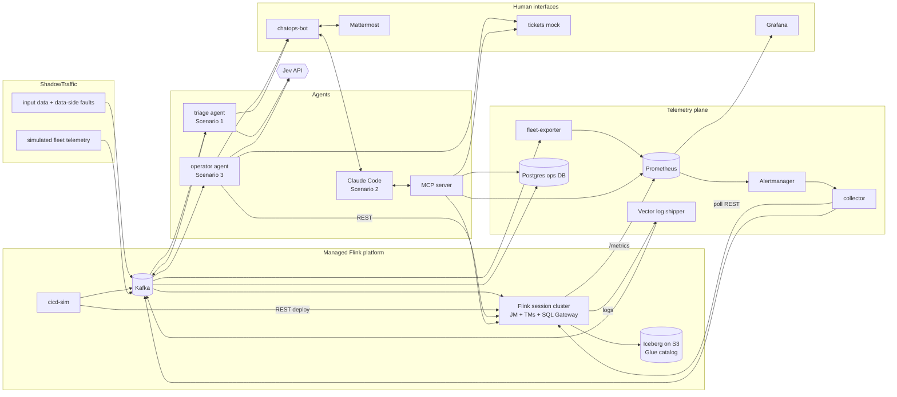

# Demo Design: From Alerts to Autonomy

Status: draft, 2026-10-20. Authors: Bobby Calderwood, Andrew Lee, with Claude Code.

This document describes the demos for the talk *From Alerts to Autonomy: Advancing the Maturity Curve with Agentic Managed Streaming Platforms*. The talk abstract is in [README.md](../README.md).

## 1. Goals

Three live demos, one for each stage of the agentic support maturity curve:

1. **Amplify signal, suppress noise.** A flood of fleet alerts becomes a small number of real, enriched signals.
2. **Human-initiated, agent-assisted diagnosis and remediation.** An engineer asks an agent about an incident in ChatOps. The agent correlates logs, metrics, deployment history and point-in-time state, finds the root cause and proposes a fix. The human approves it.
3. **Agent-initiated diagnosis and remediation.** An agent handles routine incidents end to end: it remediates, verifies the fix, keeps the ticket and the humans informed, and escalates only when necessary.

**Each scenario builds on the previous one.** The signals Scenario 1 produces are what Scenario 2's engineer investigates and what Scenario 3's agent acts on. The talk progresses along the maturity curve on one platform, rather than through three separate demos.

The audience is Current attendees who run, or will run, Flink for many user teams. The demos must:

- **Be believable.** Use real Flink, real Kafka, real Iceberg on real S3, and real REST API calls for remediation.
- **Show scale.** The noise problem only appears with a large fleet, so the demo simulates one.
- **Be repeatable.** Timelines are scripted and seeded so the live run matches rehearsal.
- **Be legible.** The audience can see where the model makes a judgment and where code enforces policy.

The business logic of the Flink jobs doesn't matter. The talk is about operating many opaque, user-provided jobs.

### Non-goals

- Production-grade infrastructure, high availability or security hardening. The setup is a single instance used only for the demo.
- A general-purpose agent framework.
- Running OpenJev/SemIf locally. Hosted Jev is the default; see §6.

## 2. Decisions

| # | Decision | Rationale |
|---|---|---|
| D1 | **Real Flink in Docker Compose**, with a handful of real jobs | Real telemetry, and remediation that really changes things |
| D2 | **ShadowTraffic** for input data to the real jobs and for **simulated fleet telemetry** | Supplies the scale and noise Scenario 1 needs without running thousands of jobs |
| D3 | **One telemetry plane**: simulated telemetry uses the same schemas and metric names as real telemetry | Agents treat real and simulated jobs the same way |
| D4 | **Scripted, seeded timelines** run by a director CLI | Fewer surprises during the live demo |
| D5 | **Jev for Scenarios 1 and 3**: typed `choice` / `noul` / `score` judgments over a finite set of outcomes | Deterministic, auditable, and every outcome maps to an action |
| D6 | **Claude Code for Scenario 2**, over an MCP server we build, bridged into Mattermost | Conversational investigation that stays in the ChatOps UI |
| D7 | **Rust, no agent harness**: explicit state machines, the `typesafe-ai` crate for Jev, `reqwest` for tools, `rmcp` for MCP | Jev isn't a tool-calling chat model, and code owns the workflow |
| D8 | **Swappable Jev endpoint** (Jev or OpenJev/SemIf via `base_url`) | Not tied to one provider. Both share the `/v1/systemone` API |
| D9 | **Mattermost in Compose** for ChatOps; **ServiceNow-shaped mock** for ticketing | Good visuals with nothing to procure; tickets appear as rich cards in chat |
| D10 | **Demo runs on one EC2 instance** (Graviton) using the same Compose stack. The laptop is for development and is the fallback | Relieves the 18 GB laptop limit, and the arm64 images are shared with the M3 |
| D11 | **Real S3 + AWS Glue Data Catalog** for Iceberg, checkpoints and savepoints on AWS. RustFS (S3-compatible) + Iceberg REST catalog locally | Believability; Glue is the simplest catalog. MinIO no longer publishes container images, so the local store is RustFS |
| D12 | **SSM Session Manager port forwarding** for access | No inbound ports, and only the AWS CLI is needed |
| D13 | **CloudFormation (plain YAML)** for infrastructure | See §10.1 |
| D15 | **Anthropic API** for Claude Code and **hosted Jev API**, with keys in SSM Parameter Store | Both keys are already available |
| D16 | **Each scenario builds on the last**: Scenario 1 signals start Scenarios 2 and 3 | One continuous story along the maturity curve |
| D14 | **Hedges come last**: a recorded replay fallback and similar safety nets are built only after the real thing works | Get the real thing running first |

## 3. System overview



Kafka is the event bus for all telemetry. The Postgres ops DB is the queryable history: point-in-time state, deployments, alerts, signals and actions. Prometheus holds all metrics, real and simulated.

## 4. Platform

### 4.1 Flink

- A **session cluster**: one JobManager, one or two TaskManagers, and the SQL Gateway. Flink 2.1.2: the newest release that both the Kafka connector (`5.0.0-2.1`) and the Iceberg Flink runtime (`iceberg-flink-runtime-2.1:1.11.0`) support.
- **Adaptive scheduler** enabled, so a rescale is a `PUT /jobs/:jobid/resource-requirements` call. TaskManagers keep spare slots so a rescale has room.
- **Short checkpoint interval (about 10 s)** and short timeouts, so failures show up within seconds, not minutes.
- **Retained checkpoints**, so a rollback can restore the previous version from the last good checkpoint.
- **Prometheus reporter** on the JobManager and TaskManagers.
- **Structured JSON logs** via the log4j2 `JsonTemplateLayout`, collected by Vector from container stdout.
- **State and checkpoints** go to `s3://…/checkpoints` and `s3://…/savepoints` on AWS, and to RustFS locally, through the Flink S3 filesystem plugin.

### 4.2 Jobs

A small set of jobs. Each one owns at most one starring failure mode (§7). Names and tenants are fictional.

| Job | Kind | Tenant (owner team) | Role in demo |
|---|---|---|---|
| `payments-enrichment` | Java DataStream | payments-eng | F1 bad deploy → Scenario 3 auto-rollback |
| `trade-events-ingest` | Java DataStream | trading-data | F2 poison records, with a recent benign deploy as a red herring → Scenario 2 |
| `positions-aggregator` | Java DataStream (keyed state) | risk-platform | F4 state growth → Scenario 3 escalation |
| `market-data-to-iceberg` | Flink SQL | market-data | F3 traffic spike / backpressure → Scenario 3 auto-rescale |
| `customer-events-to-iceberg` | Flink SQL | customer-360 | F5 schema drift (stretch goal) |
| `audit-log-archiver` | Flink SQL | compliance-eng | Healthy control job, deployed often |

All Java jobs come from **one jar** with a `--job=<name>` entry point and **fault flags** (`--fault=npe-on-null-field`, `--fault=state-leak`, …). A "buggy version" is just a version whose deployment config sets a fault flag. Java jobs also support `--on-deser-error=fail|dlq`, which gives Scenario 2 a realistic fix.

SQL jobs are submitted as SQL scripts through the SQL Gateway REST API.

All jobs read Kafka topics and write Iceberg tables (`<tenant>.<table>` in Glue).

### 4.3 CI/CD simulator (`cicd-sim`)

A Rust service that acts as the platform's deployment pipeline:

- A **version catalogue** (YAML in the repo) lists each job's versions: version number, commit SHA, author, change summary, and the jar or SQL plus flags.
- **Deploy** = stop-with-savepoint on the running version (if any), then submit the new version from that savepoint, using `/jars/upload` + `/jars/:id/run` or SQL Gateway.
- Emits a **`platform.deployments`** event for each deploy: job, from-version, to-version, SHA, author, summary, timestamp, outcome.
- Exposes a small **HTTP API** (`POST /deploy`, `POST /rollback`) used by the director, the operator agent and approved Scenario 2 remediations. Rollbacks go through the same pipeline, so they produce deployment events too.

ShadowTraffic emits `platform.deployments` events for the simulated fleet in the same schema.

### 4.4 ShadowTraffic

ShadowTraffic runs as several containers, all with `--seed`:

- **`st-inputs`**: steady input data for the real jobs' Kafka topics.
- **`st-fleet`**: telemetry for about 1,000 fictional jobs across about 40 tenants. It covers the job registry, deployments, job status transitions, checkpoint events, log events and metric samples, published to the same `platform.*` topics as the real jobs. It contains realistic noise (§7.2) and a few genuine fleet problems.
- **Fault injectors** are short-lived ShadowTraffic runs that the director starts at scripted moments (`maxMs` / `maxEvents`), for example poison records into `trade-events` or a traffic spike into `market-data`. Running separate containers makes fault timing exact, without relying on ShadowTraffic `schedule.stages`, which runs stages one after another.

ShadowTraffic can also write Iceberg directly to Glue. We may use that to fill fleet tables for visual realism, but it's optional.

### 4.5 AWS deployment

- **One EC2 instance**: `m7g.2xlarge` (8 vCPU, 32 GB, arm64), Amazon Linux 2023, Docker with the Compose plugin, and a 100 GB gp3 volume.
- **Compose files**: `compose.yml` is the base, used on the laptop with RustFS and the Iceberg REST catalog. `compose.aws.yml` is an override that drops RustFS and the REST catalog, sets the Glue catalog and S3 paths, and raises memory limits.
- **Images**: custom images (the Rust services, the jobs jar, Flink with plugins) are built on the M3 for arm64 and pushed to **ECR**.
- **Rollout**: a `make deploy-aws` target pushes images, uploads the Compose bundle to S3, and runs `docker compose pull && up -d` on the instance via **SSM Run Command**.
- **Access**: SSM port forwarding for Mattermost, Grafana, the Flink UI and the tickets UI. The security group has **no inbound rules**.
- **Secrets** (Jev API key, ShadowTraffic license, Anthropic API key, Mattermost bot token) live in **SSM Parameter Store SecureStrings**. The instance role reads them at start-up.
- **CloudFormation** (`infra/cloudformation/demo.yaml`) creates:
  - a small VPC with a public subnet and an egress-only security group;
  - the instance and its instance profile (SSM core, plus scoped S3, Glue and ECR permissions);
  - an S3 bucket for the warehouse, checkpoints, savepoints and bundles;
  - a Glue database per tenant (or a single database with a tenant prefix);
  - ECR repositories.

  It is deployed with `aws cloudformation deploy --profile evidentsystems`.

## 5. Telemetry plane

### 5.1 Kafka topics

| Topic | Producers | Contents |
|---|---|---|
| `platform.jobs` (compacted) | cicd-sim, st-fleet | Job registry: id, name, tenant, owner, tier, current version, deployed_at, first_deployed_at |
| `platform.deployments` | cicd-sim, st-fleet | Deployment events (§4.3) |
| `platform.job-status` | collector, st-fleet | Status transitions, restarts, failure causes |
| `platform.checkpoints` | collector, st-fleet | Completed and failed checkpoints: duration, size, failure reason |
| `platform.logs` | Vector, st-fleet | Structured log events: job, level, logger, message, exception class, stack-trace head |
| `platform.metrics` | st-fleet | Simulated metric samples. Real metrics are scraped directly by Prometheus |
| `platform.alerts` | collector (from Alertmanager) | Fired and resolved alerts |
| `platform.signals` | triage | Scenario 1 output: alerts with Jev judgments and a disposition |
| `platform.actions` | operator, chatops-bot, cicd-sim | Audit log of every remediation proposed, approved or executed |

The schemas live in a shared Rust crate (`platform-model`), with matching JSON Schema files that the ShadowTraffic configs target.

### 5.2 Metrics

The real Flink metrics are scraped directly. The **fleet-exporter** consumes `platform.metrics` and exposes the same metric names with the same labels (`job_id`, `job_name`, `tenant`), so a PromQL query or alert rule can't distinguish real jobs from simulated ones.

The curated metric set covers restarts, uptime, last checkpoint duration and size, failed checkpoints, backpressure time, busy time, records in/out rates, and Kafka consumer lag. The exact names will be taken from a real scrape before the fleet schema is written.

About 1,000 jobs × about 15 series is roughly 15k series, which Prometheus handles easily.

### 5.3 Alerting

Prometheus alert rules (high restarts, checkpoint failures, checkpoint duration over baseline, lag growth, backpressure, job not running) feed Alertmanager. Alertmanager sends to the collector's webhook, which publishes to `platform.alerts`.

The rules are **deliberately naive**, the kind of static thresholds every platform starts with, so the fleet produces a realistic stream of false positives. That stream is shown raw in `#platform-alerts` in Mattermost: this is the "before" picture.

### 5.4 Ops DB

A Postgres database (`ops`) is filled from Kafka by the collector. It holds jobs, deployments, job status, checkpoints, recent logs (a retention window per job), alerts, signals and actions. Agents and the MCP server query it for point-in-time context ("what was deployed, and what did checkpoints look like, before the first alert?").

The same Postgres instance hosts the `mattermost` and `tickets` databases, to save memory.

## 6. Models

### 6.1 Jev (Scenarios 1 and 3)

- Calls `POST /v1/systemone` through the `typesafe-ai` crate, with `model = jev-latest` and the base URL from config. Pointing the base URL at an OpenJev/SemIf server (same API) switches models.
- **Code computes features; Jev judges.** Agents build a compact JSON `state` from evidence fetched by code, then ask several independent questions in one request:
  - job identity, tier and age;
  - recent deployments;
  - metric summaries computed in code, e.g. "checkpoint duration p50 is 8.2 s vs a 7-day baseline of 1.1 s";
  - the top distinct exception messages with counts;
  - alert history (flapping count).
- **Jev doesn't write text.** Ticket notes and chat messages are code templates filled with structured answers and evidence. Keeping Scenario 3 free of free-form generation is part of the message.
- **Every judgment is logged** with its state, questions and answers in `platform.signals` / `platform.actions`, for auditing and so the audience can see the probabilities.
- Thresholds are set in config and tuned against the scripted scenarios.

### 6.2 Claude Code (Scenario 2)

- Runs headless inside the chatops-bot container (`claude -p --output-format stream-json --resume <session>`), with one session per Mattermost incident thread. It is configured with our MCP server and a system prompt describing the platform.
- Credentials come from an Anthropic API key in Parameter Store (in a local `.env` on the laptop).
- Read-only MCP tools are pre-approved. Mutating actions are **not** MCP tools. Claude can only *propose* a remediation, which shows up as an approval card (§8.2).

## 7. Failure-mode catalogue

### 7.1 Starring incidents (real jobs)

| ID | Failure | Injection | Symptoms | Correct diagnosis | Remediation | Autonomy |
|---|---|---|---|---|---|---|
| F1 | Bad deploy: NPE on a field that is sometimes null | cicd-sim deploys `payments-enrichment` v(n+1) with `--fault=npe-on-null-field` | Exception storm, restart loop, checkpoints stop | Code regression from the deploy N minutes ago; the previous version was healthy for days | Roll back to v(n) from the last good checkpoint; ticket to the owner for a code fix | **Auto** (Scenario 3) |
| F2 | Poison records upstream | Fault injector sends malformed records to `trade-events`; a benign deploy of `trade-events-ingest` happened 40 min earlier | Deserialization exceptions, restart loop | **Not** the deploy: exceptions start at the first malformed offset, the deploy's change summary doesn't touch parsing, and the bad records come from one producer | Redeploy the same version with `--on-deser-error=dlq`; ticket to the upstream producer team | **Human-approved** (Scenario 2) |
| F3 | Traffic spike → backpressure | Fault injector raises `market-data` volume 5–10× | Backpressure, rising checkpoint duration, growing lag; no errors | Under-provisioned for the load; no code or data problem | Rescale parallelism 2→4 (within policy bounds); verify lag drains | **Auto** (Scenario 3) |
| F4 | Unbounded state growth | `positions-aggregator` version with `--fault=state-leak` (no state TTL), deployed early in the timeline | Checkpoint size grows steadily and durations grow; eventually TaskManager memory pressure | Needs a code change (state TTL); a restart only buys time | Escalate to the owner with evidence; offer a temporary mitigation (restart with more memory) as a button | **Escalate** (Scenario 3) |
| F5 | Schema drift breaks the Iceberg write | Input gains a field / changes a type | Sink write or commit failures | Upstream schema change incompatible with the table | Escalate to the owner and upstream team | **Escalate** (stretch goal) |

### 7.2 Fleet noise and hidden true positives (simulated)

Noise that Scenario 1 should suppress or group:

- Restarts right after a deploy that recover within one checkpoint interval. These are expected.
- Single transient TaskManager-loss restarts that recover on their own.
- Lag spikes during each tenant's known daily peak, which drain within the window.
- Checkpoint-duration blips that don't persist.
- Jobs whose alerts flap all the time and that were triaged long ago (the "known noisy" list).
- Alert storms: one underlying problem firing five rules at once. These should be grouped, not counted five times.

A few genuine fleet problems (e.g. a simulated job in a slow crash loop with nobody watching) must show up as signals alongside F1–F4.

## 8. Scenarios

All three scenarios run on a single continuous timeline that the director drives, so the noisy fleet is always in the background. The director can also run each scenario on its own for rehearsal.

### 8.1 Scenario 1: amplify signal, suppress noise

**Triage agent** (`agents/triage`): consumes `platform.alerts`. For each alert (or each group of alerts for the same job within a short window), it gathers context from the ops DB and Prometheus and asks Jev, in one request:

| Question | Type | Purpose |
|---|---|---|
| `actionable` | noul | Does the evidence show a genuine, persistent problem that needs operator action, rather than a transient or expected condition? |
| `failure_class` | choice | `code_regression`, `bad_input_data`, `resource_saturation`, `state_growth`, `schema_mismatch`, `platform_infrastructure`, `transient_or_expected`, `unknown` |
| `user_impact` | score | none → slight delay → stale data → stopped / data at risk |
| `deploy_related` | noul | Did the most recent deployment probably cause these symptoms? (Only asked when a deployment is in the window.) |
| `same_incident` | choice | One of the currently open incidents for this job or tenant, or `none` |

**Code policy** decides one of three dispositions: `suppress`, `attach to incident X`, or `raise signal`. Every outcome goes to `platform.signals`.

Raised signals appear in `#platform-signals` as rich cards showing job, tenant, class, impact, probabilities, related deploy and a link to the evidence.

**What the audience sees:** `#platform-alerts` scrolling non-stop next to a calm `#platform-signals`, plus a counter (in Grafana or a pinned Mattermost post) of alerts in, signals out and alerts suppressed.

### 8.2 Scenario 2: human-initiated, agent-assisted (F2)

1. The triage agent raises a signal for `trade-events-ingest`: class `bad_input_data` or `code_regression`, with high impact and a deploy 40 min earlier.
2. An engineer replies in the signal's thread: *"@ops-assistant what's going on here? Was it the deploy?"*
3. **chatops-bot** passes the thread to Claude Code and streams its progress into the thread as short status lines ("🔎 checking deployment history…", "📈 querying lag for trade-events-ingest…").
4. Claude investigates through MCP tools:
   - `get_signal`, `get_job`, `get_deployments` (including diffs and change summaries), `query_prometheus`, `get_logs`, `get_checkpoints`;
   - `sample_topic` (recent input records around an offset), `get_ticket` / `search_tickets`.
5. Claude concludes that the deploy is a red herring and that malformed records from one producer began at offset X. It proposes: redeploy with DLQ mode, and open a ticket for the upstream team.
6. Claude calls `propose_remediation(action, params, rationale)`. The bot posts an **approval card** with **Approve** / **Reject** buttons. The engineer clicks Approve. The bot runs the action through cicd-sim, opens a ticket via the tickets mock, and posts the ticket card.
7. Claude confirms recovery when asked ("is it healthy now?").

Mutations only happen through the approval card, which is the human in the loop. Every proposal and approval is written to `platform.actions`.

### 8.3 Scenario 3: agent-initiated (F1, F3, F4)

**Operator agent** (`agents/operator`): consumes `platform.signals` with disposition `raise` and runs one explicit state machine per incident:

```
Gather → Decide → (Guardrails) → Act → Verify → Close
                       └─► Escalate
```

- **Gather:** the same context as triage, plus the previous healthy version, slot availability and the policy for this tenant or tier.
- **Decide:** Jev `remediation` choice: `rollback_to_previous_version`, `restart_from_checkpoint`, `scale_up`, `escalate_to_owner`, `escalate_to_platform`, `observe`. Each option has criteria describing when it applies.
- **Guardrails (code):** a policy table maps failure class to the actions allowed without a human. For example, a rollback is allowed only if the deploy is under 2 hours old and the previous version was healthy for at least 24 hours; a scale-up only stays within the tenant's maximum parallelism and slot availability. Each action must also clear a confidence threshold, and each job has an action budget (at most 1 automatic action per hour). Anything else becomes an escalation.
- **Act:** call cicd-sim or the Flink REST API. Open a ticket (*"File a ServiceNow ticket"* is itself one of the outcomes) and add work notes at every step.
- **Verify:** after a scripted settle window, ask Jev a `recovered` noul over before/after metric summaries. If it hasn't recovered, escalate.
- **Close:** resolve the ticket (or assign it to the owner for follow-up, e.g. the code fix after F1) and post a summary card in Mattermost tagging the owning team as **FYI**.

On the timeline:

- **F1:** auto-rollback, with the ticket opened and resolved within about 2 minutes, while the room watches.
- **F3:** auto-rescale; lag drains in Grafana.
- **F4:** the agent decides it can't fix this safely. It escalates with evidence, and the card offers **Acknowledge** and **Restart with more memory (temporary)** buttons. This is the "human only when necessary" moment.

## 9. Human interfaces

### 9.1 Mattermost

- Channels: `#platform-alerts` (raw firehose), `#platform-signals` (triage output), `#platform-incidents` (operator activity, one thread per incident).
- Bots: `triage-bot`, `operator-bot` and `ops-assistant` (Claude). The three personas make it obvious which stage of the maturity curve is acting.
- Rich posts use **message attachments** (colour bar, fields, title link) and **interactive buttons**. Mattermost needs `AllowedUntrustedInternalConnections` set to allow the chatops-bot hostname for button callbacks inside Compose.
- **chatops-bot** (Rust) uses the Mattermost REST API plus a WebSocket for events, serves button callbacks, and runs the Claude Code bridge. The triage and operator agents post through it, so all Mattermost formatting lives in one place.

### 9.2 Tickets mock

- A Rust (`axum`) service with a **ServiceNow Table API-shaped** interface: `POST/GET/PATCH /api/now/table/incident`, `sys_id`, `number` (`INC0010001…`), `state`, `priority`, `assignment_group`, `short_description`, `work_notes`. Real ServiceNow clients would therefore work against it.
- A small, generic ticket web UI with Open Graph tags, so the link renders a preview card. It is not styled to look like ServiceNow.
- Data lives in the `tickets` Postgres database.

### 9.3 Grafana

A single dashboard: alerts in vs. signals out, and a per-job panel for the starring jobs (restarts, checkpoint duration and size, lag, parallelism) annotated with deployments and agent actions. On stage it sits next to Mattermost.

## 10. Repository layout and tooling

```
compose.yml                 # base (laptop: RustFS + Iceberg REST catalog)
compose.aws.yml             # override (S3 + Glue, bigger heaps)
Cargo.toml                  # Rust workspace
crates/
  platform-model/           # shared event types and schemas
  platform-clients/         # Flink REST, Prometheus, ops DB, tickets, chatops clients
services/
  collector/                # Flink REST poller, Alertmanager webhook, Kafka→Postgres
  fleet-exporter/
  cicd-sim/
  tickets/
  chatops-bot/              # Mattermost bot + Claude Code bridge
  mcp-server/               # rmcp
agents/
  triage/                   # Scenario 1
  operator/                 # Scenario 3
director/                   # demo CLI: reset, run timelines, status
jobs/
  java/                     # single jar, --job and --fault flags
  sql/
  versions.yaml             # cicd-sim version catalogue
shadowtraffic/
  inputs.json  fleet.json  faults/*.json
observability/              # Prometheus rules, Alertmanager, Grafana, Vector configs
infra/cloudformation/demo.yaml
docs/
```

To save memory, the small Rust services may ship as one image whose binary takes a subcommand per service.

### 10.1 CloudFormation vs. CDK

**Decision: plain CloudFormation YAML.** The stack is about a dozen resources: VPC, subnet, security group, instance, role, bucket, Glue databases, ECR repositories and parameters. A single template deployed with `aws cloudformation deploy` needs no extra toolchain. CDK would add a Node or Python toolchain for little benefit, and there's no Rust CDK. CDK becomes worth it if the infrastructure grows to many similar resources or needs real logic.

### 10.2 Director

The `director` CLI (Rust):

- `reset`: cancel jobs, truncate ops and ticket tables, archive and re-create the Mattermost channels, and redeploy the baseline versions.
- `run [--scenario 1|2|3|all]`: start the seeded ShadowTraffic containers and execute the timeline (deploys and fault injections at fixed offsets).
- `status`: show progress through the timeline.

The timeline is a YAML file in the repo.

## 11. Resource budget

These are estimates to check against real usage.

| Component | Laptop (dev) | EC2 (demo) |
|---|---|---|
| Kafka (KRaft, 1 broker) | 1 GB | 1.5 GB |
| Flink JM + SQL Gateway | 1.5 GB | 2 GB |
| Flink TaskManagers | 1 × 3 GB | 2 × 4 GB |
| ShadowTraffic (inputs + fleet + one fault) | 2 GB | 3 GB |
| Postgres | 0.5 GB | 1 GB |
| Mattermost | 0.75 GB | 1 GB |
| Prometheus + Alertmanager + Grafana | 1 GB | 1.5 GB |
| Vector | 0.1 GB | 0.1 GB |
| Rust services + agents | 0.3 GB | 0.3 GB |
| Claude Code (Node) | 0.5 GB | 0.5 GB |
| RustFS + Iceberg REST catalog | 0.75 GB | — |
| **Total** | **≈ 11.5 GB** | **≈ 19 GB** of 32 GB |

On the laptop the fleet can be scaled down (e.g. about 200 simulated jobs) during development.

## 12. Milestones

Progress is tracked in [GitHub Issues](https://github.com/bobby/current-2026-san-francisco/issues) #1–#12, under the "Platform foundation" and "Agentic scenarios" GitHub milestones.

1. **Platform skeleton (laptop):** Kafka, Flink, RustFS + REST catalog, Postgres, Prometheus. One SQL job and one Java job fed by `st-inputs`, writing to Iceberg.
2. **AWS early:** the CloudFormation stack, ECR, the Compose override, S3 + Glue, SSM access. Proves the target environment before more is built on top.
3. **Telemetry plane:** collector, Vector, fleet simulation + fleet-exporter, alert rules, the ops DB.
4. **Deploys and faults:** cicd-sim, the version catalogue, fault flags, fault injectors, the director.
5. **Humans:** Mattermost, chatops-bot cards and buttons, the tickets mock, Grafana.
6. **Scenario 1:** the triage agent and Jev question tuning.
7. **Scenario 3:** the operator agent, guardrails, verification.
8. **Scenario 2:** the MCP server and the Claude Code bridge.
9. **Hedges:** a recorded replay fallback, a rehearsal checklist, and timing on the laptop vs. EC2.

## 13. Open questions

None at present.

### Resolved

- **F5 schema drift:** kept as a stretch goal.
- **Job and tenant names:** the fictional finance-themed names in §4.2 are fine.
- **IaC:** CloudFormation (D13).
- **Credentials:** an Anthropic API key and a Jev API key, both available (D15).
- **Scenario 2 trigger:** the triage signal from Scenario 1; each scenario builds on the last (D16).
- **Fleet size:** about 1,000 simulated jobs is enough.
